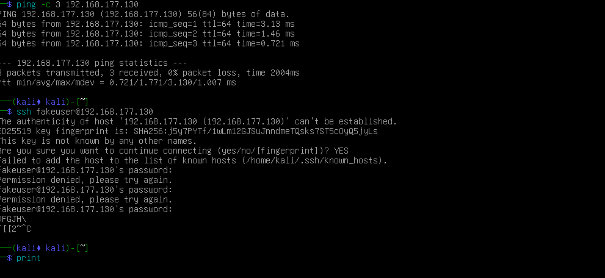
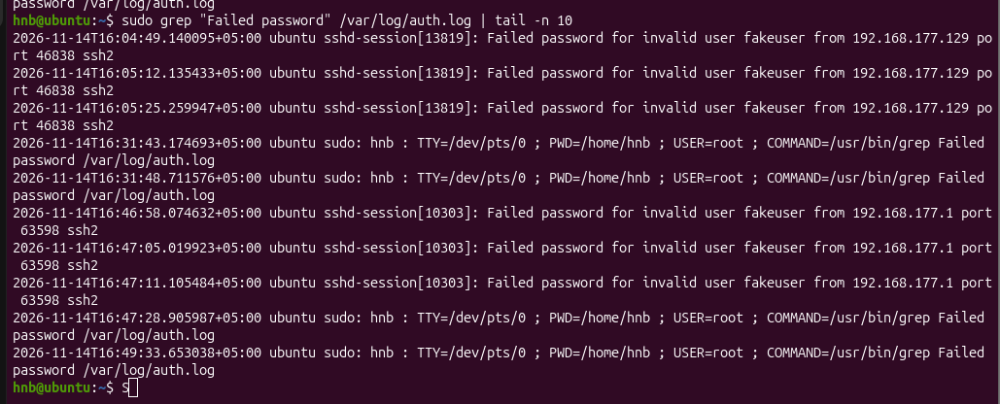
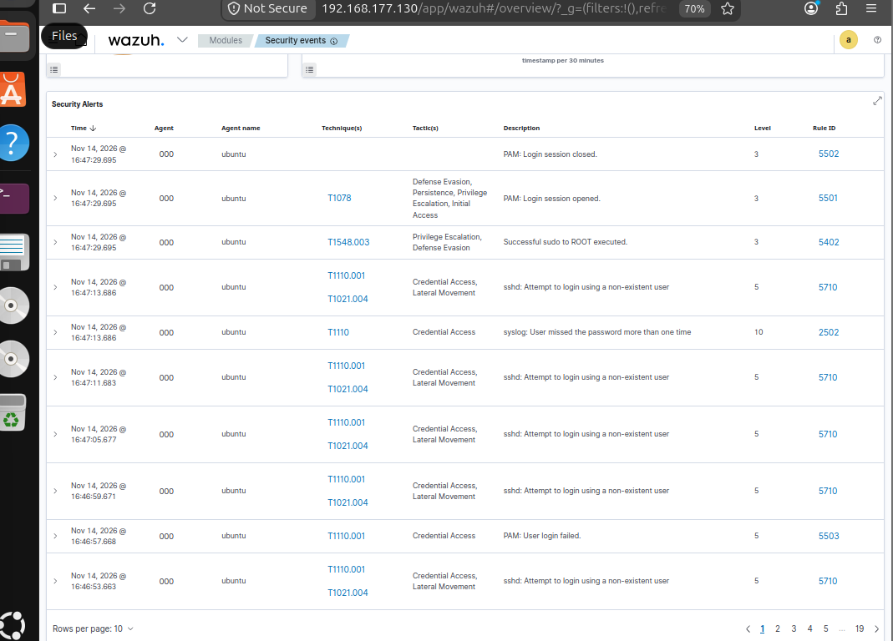

# SSH Brute-Force Detection

## Scenario
An attacker tries to guess the SSH password for a non-existent account (`fakeuser`) on the Ubuntu server, by repeatedly connecting and submitting wrong passwords in quick succession.

## Lab setup
| Machine | Role | IP |
|---|---|---|
| Ubuntu VM | Target (SSH server, Wazuh agent) | lab-internal (private VM network) |
| Attacker machine | Source of login attempts | lab-internal (private VM network) |
| Wazuh server | SIEM, correlates the alerts | - |

## Attack
Ran repeated SSH login attempts against the Ubuntu VM's SSH service with a non-existent username and wrong passwords, spaced seconds apart:

```bash
ssh fakeuser@<ubuntu-vm-ip>
```



## Raw log (/var/log/auth.log)
```
2026-11-14T16:46:58.074632+05:00 ubuntu sshd-session[10303]: Failed password for invalid user fakeuser from <attacker-ip> port 63598 ssh2
2026-11-14T16:47:05.019923+05:00 ubuntu sshd-session[10303]: Failed password for invalid user fakeuser from <attacker-ip> port 63598 ssh2
2026-11-14T16:47:11.105484+05:00 ubuntu sshd-session[10303]: Failed password for invalid user fakeuser from <attacker-ip> port 63598 ssh2
```
Three failed attempts, same source IP, each about 6-7 seconds apart - a pattern consistent with scripted/automated guessing rather than a human mistyping.



## Wazuh alerts
| Time | Rule ID | Level | Description | MITRE |
|---|---|---|---|---|
| 16:46:53-16:47:11 | 5710 (x5) | 5 | sshd: Attempt to login using a non-existent user | T1110.001, T1021.004 |
| 16:46:57 | 5503 | 5 | PAM: User login failed | T1110.001 |
| 16:47:13 | 2502 | 10 | User missed the password more than one time | T1110 |



Wazuh correlated the repeated single-failure events (level 5) into a single higher-severity alert (rule 2502, level 10) once the failure count crossed its threshold within the time window - this is the actual "brute force detected" moment, not just a logged failure.

## Detection logic (how it was caught)
- Rule 5710 fires on each individual failed login for an unknown/non-existent user.
- Rule 2502 fires when Wazuh sees multiple password failures from the same source within a short window, escalating severity from 5 to 10.
- Mapped to MITRE ATT&CK T1110 (Brute Force) / T1110.001 (Password Guessing), tactic: Credential Access.

## Response (what an analyst should do)
1. Contain: block the source IP at the firewall (sudo ufw deny from <attacker-ip>) or rate-limit SSH.
2. Investigate: confirm no login succeeded (sudo grep "Accepted password" /var/log/auth.log returned nothing for this window).
3. Harden: move to SSH key-based auth, disable password login (PasswordAuthentication no in sshd_config), add fail2ban.
4. Recover: no action needed here since no account was compromised; document and close.

## What I learned
- A single failed login is low-severity noise; Wazuh's correlation rules (not just raw log lines) are what turn repeated noise into a real "attack detected" alert.
- Matching the SIEM alert timestamps back to the raw log is what proves the alert is accurate, not a false positive.
- auth.log and Wazuh showed the same event at the same second - good sign the log pipeline is working end-to-end.
